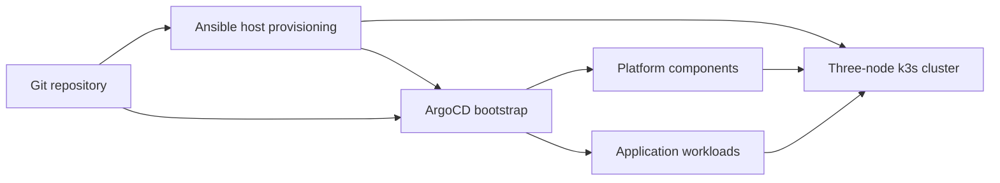

# Architecture

## Current repository

The repository contains a MkDocs documentation site, a CI workflow for
conditional documentation builds and PR-title validation, and a separate release
workflow for version tagging on `main`. CI provides a `Required checks pass` job
that verifies applicable checks and can be required in repository rules.
The workflows do not deploy infrastructure or the documentation site.

## Planned cluster

The following diagram shows the intended architecture, not a deployed system:

Rehearsal and production will share definitions, with differences expressed
through inventories and values overlays. The owner must approve changes before
an agent applies them to a live environment.

See the [initial cluster design](../superpowers/specs/2026-11-25-kubernest-design.md)
for the proposed components and unresolved choices. Update this page as
implementation establishes the actual architecture.
