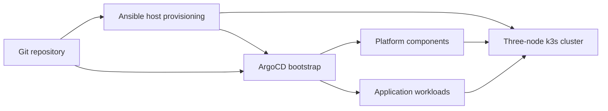

# Architecture

## Current repository

The repository contains a MkDocs documentation site, a CI workflow for
conditional documentation builds and PR-title validation, and a separate release
workflow for version tagging on `main`. CI provides a `Required checks pass` job
that verifies applicable checks and can be required in repository rules.
The workflows do not deploy infrastructure or the documentation site.

## Planned cluster

The Vagrant definition and initial Ansible connectivity check for the
three-node rehearsal environment are implemented. The k3s cluster and its
services are still planned and are not deployed.
The following diagram shows the intended cluster architecture:

Rehearsal and production will share definitions, with differences expressed
through inventories and values overlays. The owner must approve changes before
an agent applies them to a live environment.

The selected bootstrap boundaries are recorded in
[Cluster bootstrap and networking](../decisions/0002-cluster-bootstrap-and-networking.md):
k3s `v1.37.2+k3s1`, environment-specific API DNS names, MetalLB for LoadBalancer
services, k3s-managed Traefik, and a rehearsal MetalLB pool of
`192.168.56.50-192.168.56.99`.

See the [initial cluster design](../superpowers/specs/2026-11-25-kubernest-design.md)
for the proposed components and unresolved choices, and the
[rehearsal VM setup design](../superpowers/specs/2026-11-26-virtualbox-vm-setup-design.md)
and [implementation plan](../superpowers/plans/2026-11-26-virtualbox-vm-setup.md)
for the current VM setup.
