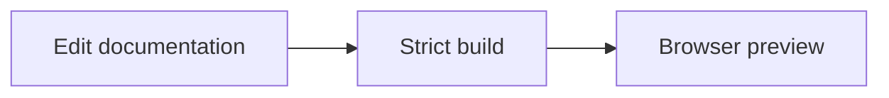

# Documentation conventions

## Locations

| Location | Content |
| --- | --- |
| Root `README.md` | Project introduction, quick start, and links into the documentation |
| `docs/index.md` | Documentation landing page and current project status |
| `docs/getting-started/` | Prerequisites and first-time setup |
| `docs/architecture/` | Current architecture; label proposed architecture as planned |
| `docs/runbooks/` | Operational procedures for existing tooling and infrastructure |
| `docs/reference/` | Configuration options, inventories, ports, and repository conventions |
| `docs/decisions/` | Numbered architecture decision records for consequential choices |
| `docs/superpowers/specs/` | Historical design intent, separate from current operational guidance |

Create a page when it has useful content, not to fill a directory.
Use numbered decision filenames such as `0001-use-mkdocs.md`.
Record the decision's status, context, choice, and consequences.

## Editing

Update affected documentation in the same PR as the behavior or configuration.
Describe implemented behavior as current and label proposed work as planned.
Link to authoritative documentation instead of copying it into several pages.

Add site pages to the navigation in `mkdocs.yml`. Use relative Markdown links
between documentation pages so links work both on GitHub and in MkDocs.
Keep linked page names and heading anchors consistent.

Runbooks should state prerequisites, target environment, commands, expected
results, and rollback or recovery steps when applicable. Do not invent deployment
commands for infrastructure that has not been implemented.

## Dependency updates

Dependabot checks GitHub Actions and the Python documentation dependencies in
`requirements-docs.txt` weekly. It groups minor and patch updates separately for
each ecosystem; major updates receive individual PRs.
Update PR titles use Conventional Commit prefixes: `ci(deps)` for Actions and
`build(deps)` for documentation packages.

The Mermaid JavaScript version in `mkdocs.yml` is a separate CDN pin.
Dependabot does not update that pin; review and update it manually, with a browser
preview of the diagrams.

## Mermaid diagrams

Write diagrams in fenced blocks labelled `mermaid`. For example:

````text

````

See the rendered diagram on the [architecture page](../architecture/index.md).
GitHub renders Mermaid blocks too.

Keep diagram source in Markdown rather than committing generated diagram images.
Preview changed diagrams in a browser: a strict MkDocs build does not validate
Mermaid syntax. The site uses the `mermaid2` plugin with a version-pinned renderer
loaded from a public CDN; offline diagram rendering is not configured.

See the [Mermaid syntax documentation](https://mermaid.js.org/intro/syntax-reference.html)
for supported diagram types.
